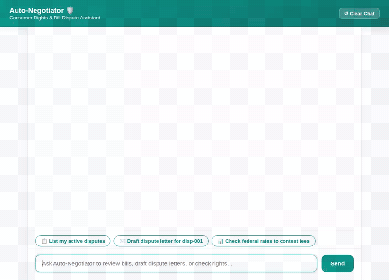

# Auto-Negotiator 🛡️

An AI-powered consumer advocate agent built with Google ADK (Agent Development Kit), Vertex AI, and Google Cloud. **Auto-Negotiator** helps everyday consumers audit, dispute, and negotiate corporate bills, bogus fees, parking tickets, and recurring subscription overcharges.



---

## What the Agent Does

Based strictly on the code implemented in `app/` and configured in `agents-cli-manifest.yaml`, the agent provides the following active capabilities:

- **Dispute Tracking & Management (Google Cloud Firestore):**
  - Manages active consumer dispute cases stored in Firestore (`disputes` collection).
  - Tools:
    - `list_disputes()`: Lists consumer disputes filtered by status (`open`, `in_review`, `resolved`).
    - `get_dispute(dispute_id)`: Retrieves full details of a specific dispute, including provider name, amount, category, and negotiation strategy notes.
    - `create_or_update_dispute(...)`: Creates new dispute records or updates existing status, deadlines, and potential savings.

- **Legal Escalation & Demand Letter Drafting:**
  - `draft_dispute_letter(...)`: Generates structured, legally grounded escalation letters citing relevant consumer protection frameworks (e.g., FCC Truth-in-Billing, FTC ROSCA for subscriptions, Fair Debt Collection Practices Act, and local municipal parking codes).

- **Benchmark Interest & Fee Analysis (U.S. Treasury Fiscal Data API):**
  - `get_federal_benchmark_interest_rates(...)`: Fetches live public benchmark interest rates from the U.S. Department of the Treasury Fiscal Data API to contest exorbitant corporate late payment penalties and arbitrary finance charges.

- **Milestone & Victory Video Generation (Google Omni Model & Cloud Storage):**
  - `generate_dispute_victory_video(...)`: Uses Google's Omni model (`gemini-omni-flash-preview`) in the `global` region via the Vertex AI Interactions API to generate animated celebration and milestone videos for resolved disputes.
  - Video bytes are recorded as a session artifact using `tool_context.save_artifact` (visible in ADK Playground) and uploaded directly to a public Google Cloud Storage bucket (`auto-negotiator-assets-8376c931`), returning a public HTTPS URL.

- **Cross-Session Long-Term Memory (Vertex AI Memory Bank):**
  - Uses `PreloadMemoryTool` and an automatic post-turn extraction callback (`add_session_to_memory`) backed by Vertex AI Memory Bank (`VertexAiMemoryBankService`).
  - Remembers user provider accounts, billing details, negotiation preferences, past dispute outcomes, and user constraints across conversations.

- **FastAPI Chat Web Frontend (A2A Protocol & A2UI Renderer):**
  - Lightweight web chat interface located in `frontend/` powered by FastAPI and the A2A (Agent-to-Agent) protocol.
  - Features sender avatars, modern dialog layout, 1-click dispute letter copying, and a client-side A2UI renderer for Card, Column, Row, Text, and List components.

---

## Architecture & Wired Google Cloud Services

| Component | Service / Technology | Status | Description |
| :--- | :--- | :--- | :--- |
| **Agent Framework** | Google ADK & Gemini Flash | **Wired & Active** | Core agent reasoning, orchestration, and callbacks |
| **Protocol** | A2A Protocol (v1.0) | **Wired & Active** | Agent-to-Agent passthrough communication |
| **Database** | Google Cloud Firestore | **Wired & Active** | Stores consumer disputes (`app/disputes_store.py`) |
| **Memory** | Vertex AI Memory Bank | **Wired & Active** | Cross-session persistent memory (`PreloadMemoryTool`) |
| **Omni Video Model** | Vertex AI (`gemini-omni-flash-preview`) | **Wired & Active** | Text-to-video generation for dispute victories (`app/video_tools.py`) |
| **Assets Storage** | Google Cloud Storage | **Wired & Active** | Public assets bucket for generated video artifacts |
| **External API** | U.S. Treasury Fiscal Data API | **Wired & Active** | Real-time federal benchmark rates for late fee disputes |
| **Web Proxy & UI** | FastAPI + HTML5 / CSS | **Wired & Active** | Web chat interface communicating with agent over A2A |

### Planned / Not Yet Implemented
- **Dynamic A2UI Surface Generation in Agent Code:** The frontend has the client-side A2UI catalog renderer, but generating dynamic A2UI surface updates directly from agent tool callbacks inside `app/` is planned.
- **Code Execution Sandbox:** Planned for complex amortized interest compounding calculations and utility bill CSV parsing.
- **Image Generation / Evidence Annotation:** Imagen-based photo evidence redaction is planned for a future release.

---

## Project Structure

```
auto-negotiator/
├── app/
│   ├── agent.py               # Root ADK agent configuration & tools
│   ├── dispute_tools.py       # Demand letter drafting tool
│   ├── disputes_store.py      # Firestore database operations
│   ├── treasury_tools.py      # U.S. Treasury API tool
│   ├── video_tools.py         # Gemini Omni video generation & Cloud Storage tool
│   ├── fast_api_app.py        # Local ADK FastAPI runner
│   └── app_utils/             # Service wiring (Memory Bank, sessions)
├── frontend/
│   ├── main.py                # FastAPI A2A proxy server
│   ├── requirements.txt       # Frontend dependencies
│   ├── Dockerfile             # Container configuration for Cloud Run
│   └── static/
│       └── index.html         # Web chat UI with A2UI renderer & copy actions
├── agents-cli-manifest.yaml   # Agent manifest configuration
├── deployment_metadata.json   # Deployment tracking info
├── pyproject.toml             # Python dependencies (UV)
├── demo.mp4                   # Recorded demo video with upbeat lo-fi audio
├── demo.gif                   # Looping inline demo animation
└── seed_firestore.py          # Script to seed initial dispute data
```

---

## Local Setup & Run Instructions

### 1. Prerequisites
- Python 3.11+
- `uv` or `pip`
- Google Cloud SDK (`gcloud`) authenticated with Application Default Credentials:
  ```bash
  gcloud auth login
  gcloud auth application-default login
  ```

### 2. Setup the Agent Backend
From the project root:

```bash
# Install dependencies
uv sync

# Run Firestore seed data (optional)
uv run python seed_firestore.py

# Launch the ADK development web UI locally
uv run adk web . --port 8080 --reload_agents
```

### 3. Setup and Run the Frontend Chat Proxy
To run the web chat interface against your agent:

```bash
cd frontend

# Install frontend dependencies
pip install -r requirements.txt

# Set your deployed agent resource name or run against local configuration
export AGENT_ENGINE_RESOURCE_NAME="projects/<PROJECT_ID>/locations/<LOCATION>/reasoningEngines/<ENGINE_ID>"
export AGENT_DIRECTORY="app"

# Start the frontend server
python main.py
```
